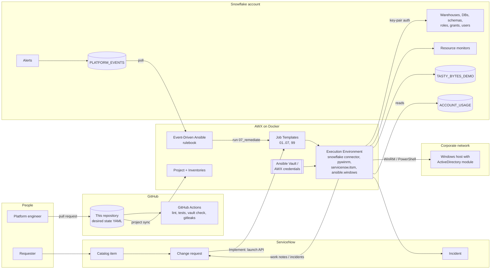
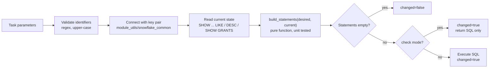
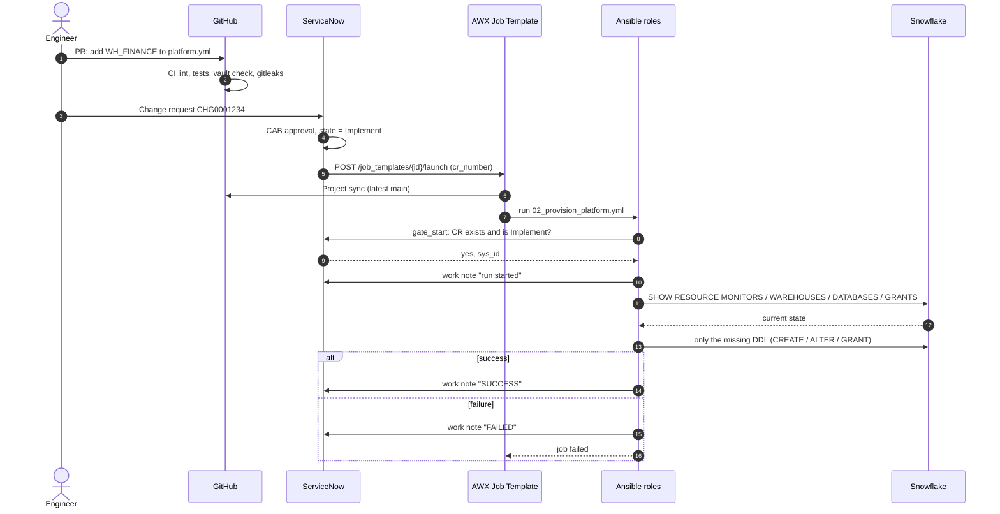
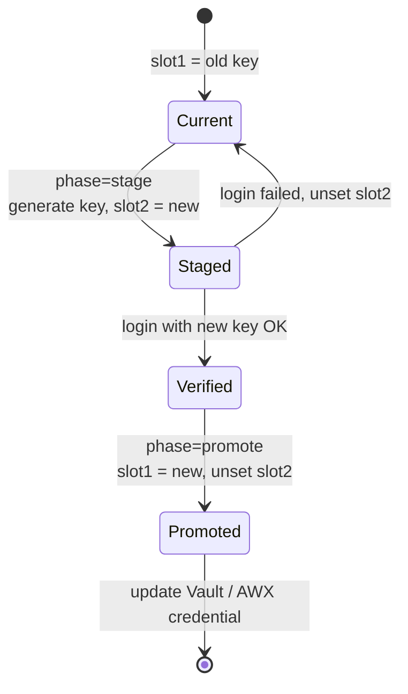
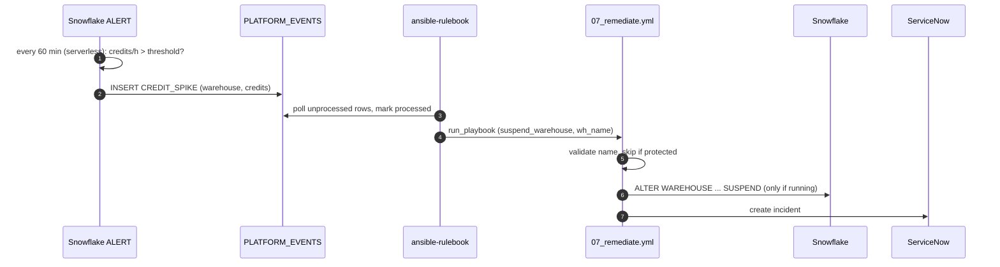
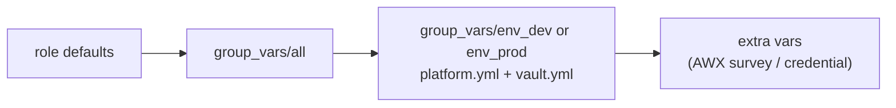
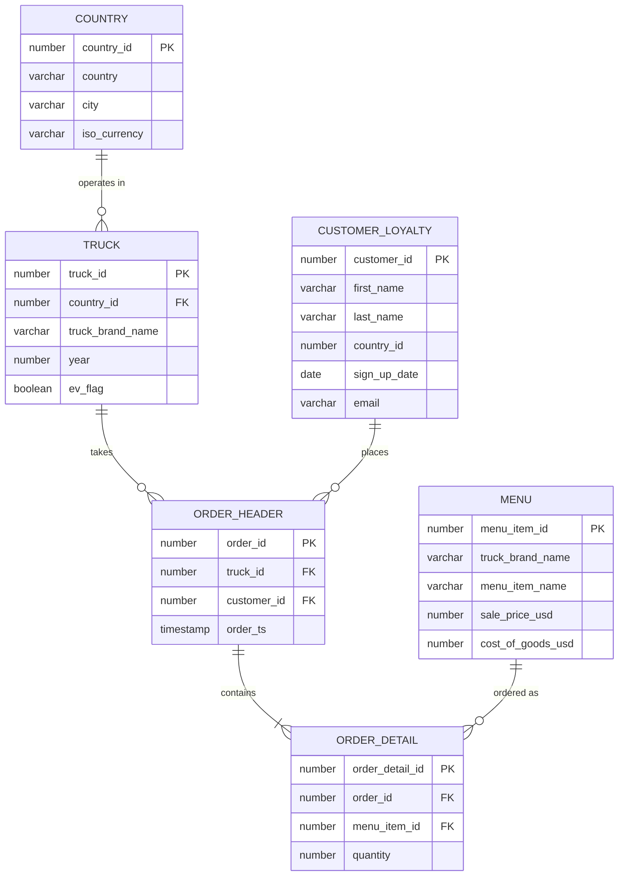
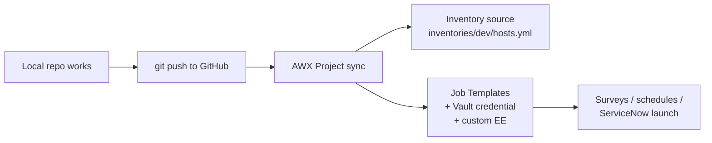

# Snowflake Platform Automation (Ansible / AWX)

**Snowflake infrastructure as code with Ansible roles and custom Python modules.** Changes are gated by
ServiceNow, run by AWX, reviewed in GitHub, and stored as YAML desired state.

> Treat Snowflake like any other infrastructure: warehouses, databases, roles, grants, users, keys,
> cost guardrails and self-healing are all **declared in Git** and **converged by Ansible**.
> Running a playbook twice gives `changed=0`.

---

## Table of contents

1. [What this project does (end to end)](#1-what-this-project-does-end-to-end)
2. [High-level design (HLD)](#2-high-level-design-hld)
3. [Low-level design (LLD)](#3-low-level-design-lld)
4. [Repository structure](#4-repository-structure)
5. [Playbooks = AWX Job Templates](#5-playbooks--awx-job-templates)
6. [Roles](#6-roles)
7. [Custom modules (iacforge.snowflake_iac)](#7-custom-modules-iacforgesnowflake_iac)
8. [Demo data model](#8-demo-data-model)
9. [Prerequisites and required collections](#9-prerequisites-and-required-collections)
10. [Secrets with Ansible Vault](#10-secrets-with-ansible-vault)
11. [Run locally (step by step)](#11-run-locally-step-by-step)
12. [Move to AWX](#12-move-to-awx)
13. [Security model](#13-security-model)
14. [Troubleshooting](#14-troubleshooting)
15. [FAQ](#15-faq)
16. [Test results](#16-test-results)

---

## 1. What this project does (end to end)

| Step | Who / what | Result |
|------|------------|--------|
| **Input** | Engineer edits `group_vars/env_dev/platform.yml` (for example adds a warehouse) and opens a PR. A ServiceNow change request is raised for prod. | Desired state in Git |
| **Gate** | GitHub Actions: yamllint, ansible-lint, playbook syntax check, vault-encryption check, secret scan. ServiceNow CR must be in *Implement* for prod. | Only reviewed, approved changes run |
| **Execute** | AWX Job Template runs a playbook. Roles call `iacforge.snowflake_iac` modules. | Snowflake converged to the desired state |
| **Operate** | Scheduled jobs: AD user sync (PowerShell over WinRM), key rotation, cost + hygiene reports. | Day-2 operations without tickets |
| **Self-heal** | Snowflake alerts write events; Event-Driven Ansible reacts (suspends runaway warehouse, retries failed task) and opens an incident. | Fewer manual interventions |
| **Output** | Work notes on the CR, HTML/CSV cost report, incidents, AWX job history. | Audit trail for every change |

---

## 2. High-level design (HLD)



**Key ideas**

- **Git is the source of truth.** Ansible converges Snowflake to what the YAML says.
- **AWX is the only actor that changes production.** People change Git; AWX changes Snowflake.
- **No passwords.** Snowflake uses key-pair auth; keys live in Ansible Vault or an AWX credential.
- **Change control is enforced by the playbook** (`servicenow_change/gate_start`), not just by process.

---

## 3. Low-level design (LLD)

### 3.1 Component map: playbook → role → module → Snowflake object

```mermaid
flowchart TB
    subgraph Playbooks
        P01[01_bootstrap.yml]
        P02[02_provision_platform.yml]
        P03[03_load_demo_data.yml]
        P04[04_user_lifecycle.yml]
        P05[05_rotate_keys.yml]
        P06[06_monitoring.yml]
        P07[07_remediate.yml]
    end

    subgraph Roles
        RB[sf_bootstrap]
        RRM[sf_resource_monitor]
        RWH[sf_warehouse]
        RDB[sf_database]
        RRB[sf_rbac]
        RDD[sf_demo_data]
        RUL[sf_user_lifecycle]
        RKR[sf_key_rotation]
        RMO[sf_monitoring]
        RRE[sf_remediation]
        RSN[servicenow_change]
    end

    subgraph Modules["iacforge.snowflake_iac modules"]
        MKP[snowflake_keypair]
        MRM[snowflake_resource_monitor]
        MWH[snowflake_warehouse]
        MDB[snowflake_database]
        MRO[snowflake_role]
        MGR[snowflake_grant]
        MUS[snowflake_user]
        MQ[snowflake_query]
    end

    subgraph External["Other collections"]
        WPS[ansible.windows.win_powershell]
        SNI[servicenow.itsm]
        AWXC[awx.awx.credential]
    end

    P01 --> RB --> MKP & MRO & MGR & MQ & MUS
    P02 --> RSN
    P02 --> RRM --> MRM
    P02 --> RWH --> MWH
    P02 --> RDB --> MDB
    P02 --> RRB --> MRO & MGR
    P03 --> RDD --> MQ
    P04 --> RUL --> WPS
    RUL --> MUS & MQ
    P05 --> RKR --> MKP & MUS & MQ
    RKR -.optional.-> AWXC
    P06 --> RMO --> MDB & MQ
    P07 --> RRE --> MWH & MQ
    RSN --> SNI
    RMO -.incident.-> RSN
    RRE -.incident.-> RSN
```



### 3.2 How every desired-state module works



### 3.3 Change-gated provisioning (02_provision_platform.yml)



### 3.4 User lifecycle (04_user_lifecycle.yml)

```mermaid
sequenceDiagram
    autonumber
    participant AWX as AWX (schedule)
    participant WIN as Windows host (WinRM)
    participant AD as Active Directory
    participant AN as sf_user_lifecycle
    participant SF as Snowflake

    AWX->>AN: run 04_user_lifecycle.yml
    AN->>WIN: win_powershell Get-ADGroupMembers.ps1 (group to role map)
    WIN->>AD: Get-ADGroupMember -Recursive, Get-ADUser
    AD-->>WIN: enabled members
    WIN-->>AN: [{name, email, roles[]}]
    AN->>AN: guard: at least min_users returned
    loop each desired user
        AN->>SF: snowflake_user (create/alter, grant/revoke managed roles)
    end
    AN->>SF: SHOW USERS (comment = managed-by:ad-sync)
    AN->>AN: leavers = managed minus desired; guard max_leavers
    loop each leaver
        AN->>SF: ALTER USER SET DISABLED = TRUE, revoke managed roles
    end
```

### 3.5 Key rotation (05_rotate_keys.yml)



### 3.6 Self-healing (Event-Driven Ansible)



### 3.7 Variable precedence used in this project



Values to the right win. AWX credential injectors and surveys are extra vars, so they override vault values.

---

## 4. Repository structure

```
snowflake-platform-automation/
├── README.md                       ← you are here
├── ansible.cfg                     roles_path, collections_path, default inventory
├── site.yml                        02 + 03 + 06 in one run
├── 01_bootstrap.yml … 99_decommission.yml   one playbook per AWX Job Template
├── inventories/
│   ├── dev/hosts.yml               groups: env_dev > snowflake (local), windows_ad (WinRM)
│   └── prod/hosts.yml
├── group_vars/                     playbook-adjacent: loaded at run time (works with AWX vault credential)
│   ├── all/main.yml                connection mapping, role names, ServiceNow defaults
│   ├── env_dev/platform.yml        DESIRED STATE for dev
│   ├── env_dev/vault.yml.example   copy → vault.yml → ansible-vault encrypt
│   ├── env_prod/…
│   └── windows_ad/main.yml         WinRM settings
├── roles/                          11 roles (see section 6), each with defaults/tasks/meta/README
├── collections/
│   └── requirements.yml            iacforge.snowflake_iac (GitHub, pinned tag), servicenow.itsm,
│                                   ansible.windows, awx.awx - installed into collections/ (git-ignored)
├── rulebooks/snowflake_self_healing.yml
├── awx/                            credential types, job templates, survey, configure_awx.yml, README
├── servicenow/                     business rule + script include that launch AWX
├── execution-environment.yml       ansible-builder definition for the AWX EE
├── requirements.txt / requirements-dev.txt
└── .github/workflows/ci.yml        lint, syntax check, vault check, gitleaks
```

The Snowflake modules live in their own repository and are consumed like any other collection:
**[iac_forge](https://github.com/piyushv080/iac_forge)** → `iacforge.snowflake_iac` (modules, unit tests, sanity tests, releases).

Why playbooks are at the repo root: Ansible automatically loads `roles/`, `collections/` and `group_vars/`
that sit **next to the playbook**. The same layout works on a laptop and in AWX with no extra configuration.

---

## 5. Playbooks = AWX Job Templates

| Playbook | Purpose | Snowflake role(s) used | Change gate | Typical trigger |
|----------|---------|------------------------|-------------|-----------------|
| `01_bootstrap.yml` | Automation role + service user + key | ACCOUNTADMIN (human admin key) | – | once |
| `02_provision_platform.yml` | Monitors, warehouses, DBs, schemas, roles, grants | ACCOUNTADMIN / SYSADMIN / SECURITYADMIN | yes | PR merge / CR Implement |
| `03_load_demo_data.yml` | Tasty Bytes style data | SYSADMIN | – | manual |
| `04_user_lifecycle.yml` | AD → Snowflake users/roles | SECURITYADMIN | yes | schedule |
| `05_rotate_keys.yml` | Two-slot key rotation | SECURITYADMIN | – | schedule (90 days) |
| `06_monitoring.yml` | Alerts, cost report, hygiene | PLATFORM_AUTOMATION_ROLE | – | daily schedule |
| `07_remediate.yml` | Suspend warehouse / retry task | PLATFORM_AUTOMATION_ROLE | – | EDA |
| `99_decommission.yml` | Drop listed objects | SYSADMIN | yes + confirm | manual |
| `site.yml` | 02 + 03 + 06 | | | manual |

Every playbook sets the Snowflake connection once:

```yaml
module_defaults:
  group/iacforge.snowflake_iac.snowflake:
    account: "{{ sf_account }}"
    user: "{{ sf_user }}"
    private_key: "{{ sf_private_key }}"
    private_key_passphrase: "{{ sf_private_key_passphrase }}"
```

---

## 6. Roles

| Role | Responsibility | Main variables |
|------|----------------|----------------|
| [`sf_bootstrap`](roles/sf_bootstrap) | automation identity | `sf_bootstrap_service_user`, `sf_bootstrap_inherited_roles` |
| [`sf_resource_monitor`](roles/sf_resource_monitor) | credit quotas | `sf_resource_monitors` |
| [`sf_warehouse`](roles/sf_warehouse) | warehouses | `sf_warehouses` |
| [`sf_database`](roles/sf_database) | databases + schemas | `sf_databases` |
| [`sf_rbac`](roles/sf_rbac) | roles, hierarchy, grants | `sf_roles`, `sf_grants` |
| [`sf_demo_data`](roles/sf_demo_data) | generated demo data | `sf_demo_*` |
| [`sf_user_lifecycle`](roles/sf_user_lifecycle) | AD sync via PowerShell | `sf_user_lifecycle_mappings` |
| [`sf_key_rotation`](roles/sf_key_rotation) | RSA rotation | `sf_key_rotation_phase` |
| [`sf_monitoring`](roles/sf_monitoring) | alerts, cost, hygiene | `sf_monitoring_*` |
| [`sf_remediation`](roles/sf_remediation) | self-healing actions | `remediation_action`, `sf_remediation_protected_warehouses` |
| [`servicenow_change`](roles/servicenow_change) | CR gate, work notes, incidents | `servicenow_enabled`, `cr_number` |

Adding a warehouse is a one-line change:

```yaml
# group_vars/env_dev/platform.yml
sf_warehouses:
  - {name: WH_FINANCE_DEV, size: XSMALL, auto_suspend: 60, resource_monitor: RM_PLATFORM_DEV}
```

---

## 7. Custom modules (iacforge.snowflake_iac)

| Module | Manages | Idempotency check |
|--------|---------|-------------------|
| `snowflake_warehouse` | size, auto-suspend/resume, monitor, comment, suspended/resumed | `SHOW WAREHOUSES LIKE` |
| `snowflake_database` | database, schemas, retention, comment | `SHOW DATABASES` / `SHOW SCHEMAS` |
| `snowflake_role` | role + parent roles | `SHOW ROLES`, `SHOW GRANTS OF ROLE` |
| `snowflake_grant` | privileges on account/warehouse/db/schema/table/view, ALL and FUTURE in schema | `SHOW GRANTS TO ROLE`, `SHOW FUTURE GRANTS` |
| `snowflake_user` | user properties, RSA key slots, role grants (movers via `roles_scope`) | `SHOW USERS`, `DESC USER` fingerprints, `SHOW GRANTS TO USER` |
| `snowflake_resource_monitor` | quota, frequency, triggers, account assignment | `SHOW RESOURCE MONITORS` |
| `snowflake_query` | SQL text or statements, returns rows; `read_only` mode | `read_only` → `changed=false` |
| `snowflake_keypair` | encrypted RSA key on the controller | file exists |

Common behaviour:

- `--check` returns the SQL that would run (`statements`) without executing it.
- Identifiers are validated (`^[A-Za-z_][A-Za-z0-9_$]*$`) before any SQL is built, so variables cannot inject SQL.
- Connection options fall back to `SF_ACCOUNT`, `SF_USER`, `SF_PRIVATE_KEY`, `SF_PRIVATE_KEY_PATH`,
  `SF_PRIVATE_KEY_PASSPHRASE`, `SF_ROLE`, `SF_WAREHOUSE`.
- Every session sets `QUERY_TAG = ansible:iacforge.snowflake_iac`, so automation queries are easy to find in `QUERY_HISTORY`.

`ansible-doc iacforge.snowflake_iac.snowflake_grant` shows full documentation.

---

## 8. Demo data model

Generated by `sf_demo_data` with `GENERATOR` (no external files), modelled on the Snowflake *Tasty Bytes* food-truck sample.



Views in `TASTY_BYTES_DEMO.ANALYTICS`: `ORDERS_V` (joined order lines with revenue and margin) and
`DAILY_SALES_V`. `PLATFORM_READER` gets `SELECT` on current and future views through `sf_rbac`.

```sql
USE ROLE PLATFORM_READER;
SELECT city, SUM(revenue_usd) FROM TASTY_BYTES_DEMO.ANALYTICS.DAILY_SALES_V GROUP BY city ORDER BY 2 DESC;
```

---

## 9. Prerequisites and required collections

| Component | Version | Why |
|-----------|---------|-----|
| ansible-core | ≥ 2.16 | runs on WSL2/Linux or inside the AWX EE (Ansible does not run natively on Windows) |
| Python packages | `snowflake-connector-python ≥ 3.10`, `cryptography ≥ 42`, `pywinrm ≥ 0.4.3` | modules, WinRM |
| `servicenow.itsm` | ≥ 2.6.0 | change gate, work notes, incidents |
| `ansible.windows` | ≥ 2.3.0 | `win_powershell` for AD sync |
| `awx.awx` | match your AWX | `awx/configure_awx.yml`, optional key update |
| `iacforge.snowflake_iac` | tag `snowflake_iac-v0.1.0` | custom Snowflake modules, from [iac_forge](https://github.com/piyushv080/iac_forge) |
| Snowflake | any edition | trial is fine; user with ACCOUNTADMIN for bootstrap |
| Windows host | RSAT ActiveDirectory, WinRM HTTPS | only for `04_user_lifecycle.yml` |
| ServiceNow | PDI is fine | optional (`servicenow_enabled: false` by default) |

Install:

```bash
python3 -m venv ~/.venv/sf && source ~/.venv/sf/bin/activate
pip install -r requirements-dev.txt
ansible-galaxy collection install -r collections/requirements.yml -p ./collections
```

---

## 10. Secrets with Ansible Vault

| Variable | Used by |
|----------|---------|
| `vault_sf_account`, `vault_sf_user`, `vault_sf_private_key`, `vault_sf_private_key_passphrase` | every playbook |
| `vault_sf_admin_user`, `vault_sf_admin_private_key`, `vault_sf_admin_private_key_passphrase` | `01_bootstrap.yml` only |
| `vault_sf_new_key_passphrase` | bootstrap, key rotation |
| `vault_win_user`, `vault_win_password` | WinRM to the AD host |
| `vault_servicenow_host`, `vault_servicenow_username`, `vault_servicenow_password` | `servicenow_change` |

```bash
cp group_vars/env_dev/vault.yml.example group_vars/env_dev/vault.yml
ansible-vault encrypt group_vars/env_dev/vault.yml
ansible-vault edit group_vars/env_dev/vault.yml
```

The encrypted `vault.yml` is committed; CI fails if it is not encrypted, or if any `.p8/.pem/.key` file is committed.

---

## 11. Run locally (step by step)

```bash
# 0. One-time: create an admin key pair for your own Snowflake user and register it
#    ALTER USER <you> SET RSA_PUBLIC_KEY='...';   then fill vault_sf_admin_* in vault.yml

# 1. Bootstrap the automation identity
ansible-playbook 01_bootstrap.yml --ask-vault-pass
#    → copy .keys/svc_platform_automation.p8 into vault_sf_private_key, delete the file

# 2. Dry run, apply, prove idempotency
ansible-playbook 02_provision_platform.yml --check --diff --ask-vault-pass
ansible-playbook 02_provision_platform.yml --ask-vault-pass
ansible-playbook 02_provision_platform.yml --ask-vault-pass        # expect changed=0

# 3. Demo data and monitoring
ansible-playbook 03_load_demo_data.yml --ask-vault-pass
ansible-playbook 06_monitoring.yml --ask-vault-pass                # reports/cost_report_dev.html

# 4. Test self-healing without waiting for a real spike
#    INSERT INTO PLATFORM_OPS.MONITORING.PLATFORM_EVENTS (event_type, object_name, detail)
#      SELECT 'CREDIT_SPIKE', 'WH_ANALYTICS_DEV', OBJECT_CONSTRUCT('credits_last_hour', 5);
ansible-playbook 07_remediate.yml --ask-vault-pass \
  -e remediation_action=suspend_warehouse -e wh_name=WH_ANALYTICS_DEV -e credits_last_hour=5

# 5. Prod needs a change number
ansible-playbook -i inventories/prod/hosts.yml 02_provision_platform.yml -e cr_number=CHG0001234 --ask-vault-pass

# Module unit tests live with the collection: https://github.com/piyushv080/iac_forge
```

---

## 12. Move to AWX

Full guide: [awx/README.md](awx/README.md). Summary:

1. Build the EE: `ansible-builder build -t snowflake-platform-ee:1.0 -f execution-environment.yml`.
2. Push the repo to GitHub with the **encrypted** vault files.
3. Run `awx/configure_awx.yml` (awx.awx), or create the objects in the UI:
   Vault credential → Project → Inventory sourced from `inventories/dev/hosts.yml` → one Job Template per playbook.
4. Attach the survey `awx/surveys/change_request.json` to templates that change things.
5. Schedule `06 Monitoring` (daily) and `04 User Lifecycle` (nightly). Point the ServiceNow business rule at `02 Provision Platform (prod)`.



---

## 13. Security model

| Control | Implementation |
|---------|----------------|
| Authentication | Key-pair only, encrypted PKCS#8, `TYPE=SERVICE` user; no passwords anywhere |
| Secret storage | Ansible Vault (committed encrypted) or AWX credential type; `no_log` on every key parameter |
| Least privilege per task | each role passes its own `role:` (ACCOUNTADMIN only for resource monitors and bootstrap) |
| SQL injection | identifiers validated by regex; string literals escaped; `snowflake_query read_only` blocks DDL/DML |
| Change control | prod requires a `CHG` number; with ServiceNow enabled, the CR must be in *Implement* |
| Blast-radius guards | AD sync min-users / max-leavers; protected warehouses never auto-suspended; decommission needs `confirm_decommission` |
| Traceability | `QUERY_TAG` on every session, CR work notes, AWX job history, Git history |
| CI | ansible-lint, yamllint, playbook syntax check, vault-encryption check, gitleaks (module tests run in the iac_forge repo) |

**Known demo shortcuts.** The automation role inherits SYSADMIN and SECURITYADMIN, and the service user holds
ACCOUNTADMIN for resource monitors. In a real enterprise, replace these with custom roles that hold only the
needed privileges (`CREATE WAREHOUSE`, `MANAGE GRANTS`, and so on).

---

## 14. Troubleshooting

| Symptom | Fix |
|---------|-----|
| `couldn't resolve module/action 'iacforge.snowflake_iac...'` | install collections first: `ansible-galaxy collection install -r collections/requirements.yml -p ./collections` (needs GitHub access while iac_forge is private), and run from the repo root |
| `'vault_sf_account' is undefined` | create and encrypt `group_vars/env_<env>/vault.yml`; pass `--ask-vault-pass` or attach the AWX Vault credential |
| `JWT token is invalid` | public key in Snowflake does not match the private key; re-run bootstrap or rotation |
| `Insufficient privileges` on alerts or ACCOUNT_USAGE | run `01_bootstrap.yml` (grants EXECUTE ALERT, MONITOR USAGE, IMPORTED PRIVILEGES) |
| WinRM `kerberos` errors | install `pywinrm[kerberos]` and krb5 in the EE, or set `ansible_winrm_transport: ntlm` |
| `servicenow.itsm` auth failure | check `vault_servicenow_*` or `SN_HOST/SN_USERNAME/SN_PASSWORD` |
| Grant always shows `changed` | use explicit privileges; check that object names match `DB.SCHEMA.OBJECT` |
| `ansible.cfg` ignored, collection not found (WSL) | do not run from `/mnt/c/...` (world-writable); clone/copy the repo into the Linux filesystem, e.g. `~/snowflake-platform-automation` |
| Rulebook: `No active warehouse selected` | set `warehouse:` on the `snowflake_events` source (or `SF_WAREHOUSE`) |

---

## 15. FAQ

**Why custom modules instead of `snowflake_query` everywhere?**
Raw SQL tasks always report `changed` and cannot support `--check` meaningfully. Desired-state modules read
the current state first, so you get honest change reporting, dry runs and repeatable deployments.

**Why are playbooks at the root and not in `playbooks/`?**
Ansible loads `roles/`, `collections/` and `group_vars/` relative to the playbook. Keeping them together
means AWX needs no special paths or environment variables.

**Does AWX need the collection installed?**
AWX installs everything in `collections/requirements.yml` on project sync, including `iacforge.snowflake_iac`
from GitHub. While the iac_forge repo is private, give the AWX Project a GitHub Source Control credential
(or make the repo public). To upgrade, change the pinned `version:` tag in `collections/requirements.yml`.

**Where did the demo data come from?**
It is generated, modelled on the public Snowflake *Tasty Bytes* sample. Nothing is downloaded.

---

## 16. Test results

Verified end to end from WSL Ubuntu (ansible-core 2.21, snowflake-connector-python 5.1, ansible-rulebook 1.3)
against a real Snowflake account:

| Area | Result |
|------|--------|
| Offline | 25 unit tests, `ansible-doc` for all 8 modules, syntax check of all playbooks, yamllint, ansible-lint (production profile) |
| Bootstrap | role, privileges, SERVICE user with key pair; re-run `changed=0`; existing user is never re-keyed |
| Provision | monitors, warehouses, databases, schemas, roles, grants created; second run `changed=0` |
| Drift | manual `ALTER WAREHOUSE` (SMALL / 3600s) reverted to Git state with a single ALTER |
| RBAC | `PLATFORM_READER` reads `ANALYTICS` views (future grants) and is denied `RAW_POS` |
| Demo data | 50 trucks, 5,000 customers, 20,000 orders, 40,000 lines; re-run skipped |
| Monitoring | serverless alerts created and executed; cost report and hygiene findings produced |
| Self-healing | real `ansible-rulebook` consumed events and ran `07_remediate.yml`; managed warehouse suspended, unmanaged/protected warehouses got an incident only |
| Key rotation | stage (old key still works) → promote (old key rejected with `JWT token is invalid`) → new key from vault works |
| Safety | prod refused without valid CR number; decommission refused without confirmation; SQL injection in `wh_name` rejected |

Not yet tested: `04_user_lifecycle.yml` (needs a Windows host with the ActiveDirectory module),
ServiceNow with a real instance (`servicenow_enabled: true`), and running from AWX.
