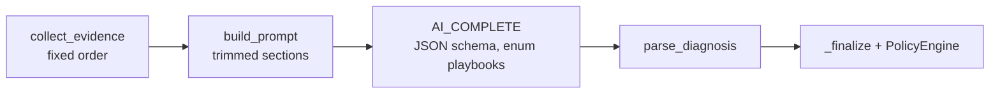

# AI Agent Architecture

## 1. LLM vs assistant vs agent

| | LLM | AI assistant | AI agent |
|---|---|---|---|
| What it does | Predicts text from a prompt | Answers a user in conversation, maybe with retrieval | Pursues a goal by **deciding** which actions (tools) to take, observing results, and iterating |
| Control flow | Caller | Caller | The model plans the next step |
| In OpsAgentX | `AI_COMPLETE` in direct mode | - (no chat UI) | Cortex Agent in agent mode |

**Why OpsAgentX is agentic.** In agent mode the code only sends `"Diagnose incident INC1001."`.
The Cortex Agent decides which of its 7 tools to call, in what order, with which arguments, reads
the results, and decides when it has enough evidence. Observed live: for disk incidents it calls
`analyze_disk_usage`; for INC1002/INC1003 it does not; for INC1002 it chose the read-only
`cpu_diagnostics.yml` because the runbook it retrieved said to diagnose first.

**What is *not* agentic.** The agent cannot act on infrastructure. Approval and execution are
deterministic Python. This is a deliberate split: *agentic diagnosis, non-agentic execution*.

Direct mode is a **fixed pipeline** (not an agent): Python calls the tools in a hard-coded order
and makes one `AI_COMPLETE` call.

## 2. Responsibilities: native vs custom

| Capability | Provided natively by Snowflake | Implemented by us |
|---|---|---|
| Planning / tool selection / tool-call loop | Cortex Agent orchestration (`claude-sonnet-4-5`, budget 90 s / 32k tokens) | Instructions in `agent/opsagentx_agent.yaml` |
| Tool execution | Agent runs UDFs on `COMPUTE_WH`; runs Cortex Search | The 6 SQL UDFs (`sql/04_agent_tools.sql`), the search service definition |
| Retrieval | Embedding, hybrid search, reranking (Cortex Search) | Indexed content (approved only), category filter, score cut-off (direct mode) |
| Text generation | `AI_COMPLETE`, structured output | Prompt, JSON schema with allowlist enum |
| Output validation | - | `parse_diagnosis` (Pydantic), `_finalize` cross-checks |
| Authorization | Snowflake RBAC on objects | `PolicyEngine`, `ApprovalService`, execution gate |
| Execution | - | `RemediationService` + `SimulatedAnsibleClient` |
| Verification | - | `RemediationService.verify` |
| Audit | Query history (native) | `AUDIT_LOGS` via `AuditService` |
| State / memory | Threads exist in the Agents API | **Not used** - each diagnosis is a single stateless run |

## 3. End-to-end agent sequence (actual call path)

```mermaid
sequenceDiagram
    actor Op as Operator
    participant UI as Streamlit (diagnosis.py)
    participant DS as DiagnosisService
    participant AR as CortexAgentRunner
    participant AG as Cortex Agent (managed)
    participant UDF as TOOL_* UDFs
    participant CS as Cortex Search RUNBOOK_SEARCH
    participant PE as PolicyEngine
    participant DB as Snowflake tables

    Op->>UI: Run AI diagnosis (mode = Cortex Agent)
    UI->>DS: diagnose("INC1001", actor, mode="agent")
    DS->>DB: audit DIAGNOSIS_REQUESTED
    DS->>AR: run("INC1001")
    AR->>AG: SELECT SNOWFLAKE.CORTEX.DATA_AGENT_RUN(agent, {"messages":[... "Diagnose incident INC1001." ...], "stream": false})
    AG->>UDF: get_incident_details(incident_id_arg="INC1001")
    UDF->>DB: SELECT INCIDENTS + SERVERS
    UDF-->>AG: {incident: server-01, development, disk_space ...}
    AG->>UDF: get_historical_incidents("disk_space")
    AG->>UDF: get_server_metrics("server-01") / get_server_logs("server-01")
    AG->>UDF: analyze_disk_usage("server-01")
    UDF-->>AG: {"/": 95% critical, tmp 18.4 GB, likely_cause: temporary directory growth}
    AG->>CS: search_runbooks(query about disk / tmp growth)
    CS-->>AG: RB-001 Linux Disk Space Troubleshooting (approved remediation disk_cleanup.yml)
    AG->>UDF: validate_remediation("disk_cleanup.yml","development","server-01","disk_space")
    UDF-->>AG: {allowed: true, requires_human_approval: true}
    AG-->>AR: {status: completed, content: [tool_use, tool_result, thinking, text JSON], metadata}
    AR-->>DS: AgentRun(final_text, tool_calls, runbook_ids, unexpected_tools=[])
    DS->>DB: audit TOOL_CALLED x7, RUNBOOKS_RETRIEVED
    DS->>DS: parse_diagnosis(final_text) (Pydantic)
    DS->>DS: _finalize: keep real id/category, force approval, flag low confidence
    DS->>PE: validate_remediation(disk_cleanup.yml, server-01, development, disk_space)
    PE->>DB: SELECT PLAYBOOKS, SERVERS
    PE-->>DS: allowed
    DS->>DB: INSERT INCIDENT_DIAGNOSIS; audit DIAGNOSIS_COMPLETED, POLICY_VALIDATED; status DIAGNOSED
    DS-->>UI: Diagnosis
    UI-->>Op: root cause, 95%, disk_cleanup.yml, tools, runbooks, "Request approval"
```

## 4. Step by step

| Question | How it works here |
|---|---|
| How does the agent receive the incident? | Only the id, in one user message. It must fetch everything else through tools - it cannot be fed misleading context by the caller. |
| How does it understand it? | `get_incident_details` returns category, environment, server, description; orchestration instructions map category → tool choices. |
| How does it retrieve information? | `get_server_logs`, `get_server_metrics`, `get_historical_incidents`, `analyze_disk_usage` (SQL UDFs); `search_runbooks` (Cortex Search, approved runbooks, `max_results: 3`). |
| How does it choose tools? | The managed orchestrator, guided by `instructions.orchestration` (7-step order, "do not call tools irrelevant to the category"). The tool list is the allowlist - there is no other tool. |
| How are tool outputs processed? | Inside the agent loop by the managed model. Afterwards `parse_agent_response` extracts the trace (`tool_use` names/inputs, search `doc_id`s). |
| Context / state? | Within one run only. No threads, no long-term memory. Re-diagnosis starts fresh. |
| How is the diagnosis generated? | `instructions.response` requires one JSON object with fixed keys. Not schema-enforced in agent mode; validated by Pydantic afterwards. |
| How is remediation recommended? | The agent picks the playbook named by the matching runbook and self-checks with `validate_remediation`; if not allowed it must answer `none`. |
| How are failures handled? | Non-`completed` status or no text → `LLMProviderError`; invalid JSON → `LLMResponseError`; non-allowlisted tool → `LLMResponseError`; all audited `DIAGNOSIS_FAILED`; `auto` mode falls back to direct. |
| How are unauthorized actions avoided? | The agent has only read-only tools (UDFs cannot write). It cannot approve or execute. Its playbook is re-checked by Python policy three more times before anything runs. |
| How does human approval work? | `ApprovalService.approve` requires a non-automated actor (the Streamlit viewer `st.user.user_name`), `confirmed=True`, a `PENDING` request, and a passing policy check. |
| How is the result verified? | `RemediationService.verify` compares a post-job metric with a threshold; the agent plays no part. |

## 5. Tool contract

| Tool (agent name) | Backing object | Input schema (from YAML) | Read scope |
|---|---|---|---|
| `get_incident_details` | `TOOL_GET_INCIDENT_DETAILS` | `incident_id_arg: string` | 1 incident + its server |
| `get_server_logs` | `TOOL_GET_SERVER_LOGS` | `server_name_arg` | 30 latest log lines |
| `get_server_metrics` | `TOOL_GET_SERVER_METRICS` | `server_name_arg` | metrics for 1 server |
| `get_historical_incidents` | `TOOL_GET_HISTORICAL_INCIDENTS` | `category_arg` | 5 resolved incidents |
| `analyze_disk_usage` | `TOOL_ANALYZE_DISK_USAGE` | `server_name_arg` | disk metrics for 1 server |
| `validate_remediation` | `TOOL_VALIDATE_REMEDIATION` | playbook, environment, server, category | PLAYBOOKS + SERVERS (advisory) |
| `search_runbooks` | `RUNBOOK_SEARCH` | managed | approved runbooks |

Real response excerpt (from `tests/fixtures/agent_response_inc1003.json`, actual):
`{"client_side_execute": false, "input": {"incident_id_arg": "INC1003"}, "name": "get_incident_details", "type": "generic"}`.

## 6. Direct mode for comparison



| | Direct (`AI_COMPLETE`) | Agent (Cortex Agent) |
|---|---|---|
| Tool choice | Python, fixed | Model decides |
| Output constraint | JSON schema enforced | Instructions only |
| Latency (live) | 13-19 s | 40-52 s |
| Tokens (live) | ~0.7-2k prompt | ~90k input (mostly cached) |
| Observed quality | Good; INC1002 skipped "diagnostics first" | Followed runbooks more closely |

## 7. Prompt-injection posture

Defenses present: input treated as data (instructions in both prompts), the agent fetches its own
context, outputs validated, playbook enum + allowlist + policy, no write tools. **Not implemented**:
content scanning of log messages for injection attempts, and an automated adversarial test set.
