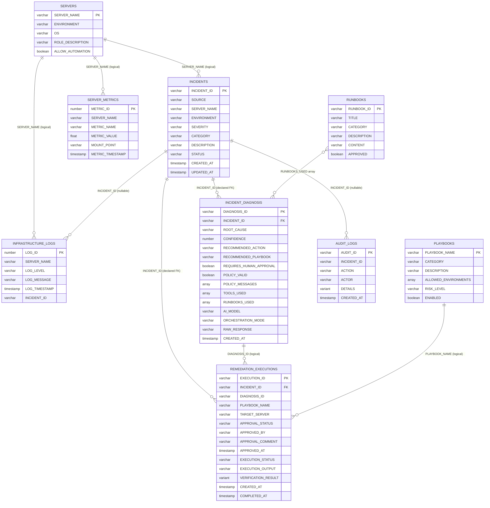

# Data Model and Data Flow

Database `OPSAGENTX_DB`, schema `OPSAGENTX_SCHEMA`. Defined in `sql/01_setup.sql`.
No views exist. Snowflake **enforces `NOT NULL` only**; `PRIMARY KEY`/`REFERENCES` are declared
for documentation and enforced in Python services.

## 1. ER diagram (actual tables)

## 2. Table reference

| Table | Purpose | Notable columns | Written by | Read by |
|---|---|---|---|---|
| `INCIDENTS` | The unit of work | `STATUS` (8 states), `ENVIRONMENT`, `CATEGORY` | `IncidentService`, `RESET_DEMO_DATA` | everything |
| `INCIDENT_DIAGNOSIS` | Validated AI results (history kept) | `POLICY_VALID`, `POLICY_MESSAGES`, `TOOLS_USED`, `RUNBOOKS_USED`, `ORCHESTRATION_MODE` (`direct_llm`/`cortex_agent`), `RAW_RESPONSE` (≤16k chars) | `DiagnosisService._store` | UI, `ApprovalService` (latest) |
| `INFRASTRUCTURE_LOGS` | Log lines | `INCIDENT_ID` nullable | `RESET_DEMO_DATA` | tools |
| `SERVER_METRICS` | Time series: `disk_used_pct`, `tmp_dir_gb`, `cpu_pct`, `memory_pct`, `service_up` | `MOUNT_POINT` (mount or service name) | `RESET_DEMO_DATA`, `RemediationService` (simulated post-state) | tools, verification, UI charts |
| `RUNBOOKS` | Knowledge base (change tracking on) | `APPROVED` (only TRUE indexed) | `RESET_DEMO_DATA` | `RUNBOOK_SEARCH`, keyword fallback |
| `SERVERS` | Target allowlist | `ALLOW_AUTOMATION`, `ENVIRONMENT` | `RESET_DEMO_DATA` | `PolicyEngine`, tools |
| `PLAYBOOKS` | Playbook allowlist | `ALLOWED_ENVIRONMENTS` ARRAY, `RISK_LEVEL`, `ENABLED` | `RESET_DEMO_DATA` | `PolicyEngine`, UI |
| `REMEDIATION_EXECUTIONS` | One row per attempt (approval + run + verification) | `APPROVAL_STATUS` (PENDING/APPROVED/REJECTED), `EXECUTION_STATUS` (7 values), `VERIFICATION_RESULT` VARIANT | `ApprovalService`, `RemediationService` | UI, gate |
| `AUDIT_LOGS` | Append-only trail | `ACTION` (20 values), `ACTOR`, `DETAILS` VARIANT | `AuditService` | Audit page |

## 3. States

* Incident: `OPEN → DIAGNOSED → PENDING_APPROVAL → APPROVED → REMEDIATING → RESOLVED | REMEDIATION_FAILED`,
  plus `REJECTED`; see `core/models.ALLOWED_TRANSITIONS`.
* Execution: `NOT_STARTED → RUNNING → SUCCEEDED | FAILED | TIMED_OUT | VERIFICATION_FAILED`;
  rejected requests go straight to `CANCELLED`.

Relationships: an incident has many diagnoses (latest wins), many executions (one per attempt);
each execution references the diagnosis it came from and freezes playbook + target at creation.

## 4. Seed data (from `RESET_DEMO_DATA`)

| Incident | Server (env) | Category / severity | Purpose |
|---|---|---|---|
| INC1001 | server-01 (development) | disk_space / high | main demo |
| INC1002 | server-02 (test) | high_cpu / high | CPU demo |
| INC1003 | server-03 (development) | service_failure / critical | stopped nginx |
| INC1004 | prod-db-01 (production, automation disallowed) | disk_space / critical | policy block |
| INC0901-INC0904 | various | RESOLVED | history for `get_historical_incidents` |

## 5. Data movement for INC1001 (from the live Stage 7 run)

| Step | Component | Data read | Data written |
|---|---|---|---|
| 1 | `RESET_DEMO_DATA` | - | INCIDENTS row `OPEN`; 4 logs; 7 metrics; audit `INCIDENT_CREATED` |
| 2 | `DiagnosisService` (agent) | - | audit `DIAGNOSIS_REQUESTED` |
| 3 | Agent tools | INCIDENTS, SERVERS, LOGS, METRICS, RUNBOOK_SEARCH, PLAYBOOKS | - |
| 4 | `DiagnosisService._store` | PLAYBOOKS, SERVERS (policy) | INCIDENT_DIAGNOSIS (`disk_cleanup.yml`, 0.95, valid, 7 tools); audit `TOOL_CALLED`×7, `RUNBOOKS_RETRIEVED`, `DIAGNOSIS_COMPLETED`, `POLICY_VALIDATED`; status `DIAGNOSED` |
| 5 | `ApprovalService.request_approval` | latest diagnosis | REMEDIATION_EXECUTIONS `PENDING/NOT_STARTED`; status `PENDING_APPROVAL`; audit |
| 6 | `ApprovalService.approve` | SERVERS, PLAYBOOKS | `APPROVED`, `APPROVED_BY=PIYUSHVERMA701`, comment; status `APPROVED`; audit |
| 7 | `RemediationService.execute` | execution, incident, policy | `RUNNING`; status `REMEDIATING`; metrics `disk_used_pct=71.5`, `tmp_dir_gb=1.2`; `SUCCEEDED`, `VERIFICATION_RESULT {before 95, after 71.5, passed}`; status `RESOLVED`; audit ×6 incl. `TICKET_UPDATED` |

Total: 24 audit rows for INC1001 in that run.

## 6. Ingestion, transformation, retrieval

* **Ingestion**: `IncidentService.ingest` (UI form) and `RESET_DEMO_DATA`. No streaming/Snowpipe/API
  ingestion (**NOT IMPLEMENTED**).
* **Transformation**: Pydantic normalization (aliases, case, trimming); `TOOL_*` UDF aggregations
  (`ARRAY_AGG`, `MAX_BY`/`MIN_BY`); Cortex Search indexing of `TITLE || DESCRIPTION || CONTENT`.
* **Retrieval**: parameterized `SELECT`s in `SnowflakeRepository`; UDF calls by the agent; Cortex Search.

## 7. Retention considerations

Not configured (**NOT IMPLEMENTED**): no retention policy, no `DATA_RETENTION_TIME_IN_DAYS`
override (account default applies), no archival. `RESET_DEMO_DATA` truncates **all** tables
including `AUDIT_LOGS` - acceptable for a demo, not for production. The Cortex Search target lag
(1 hour) must stay below the table's Time Travel retention.
