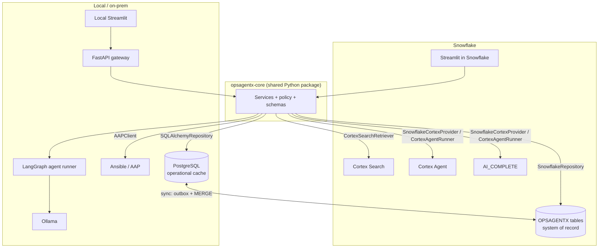
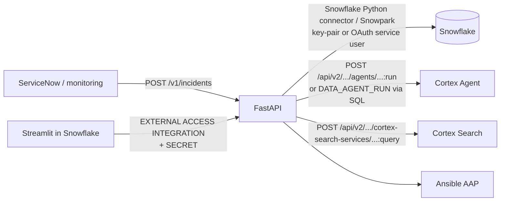
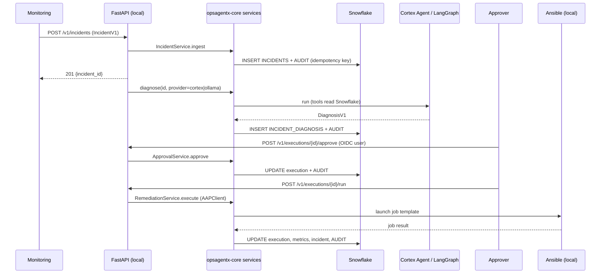

# Future Integration With the Local OpsAgentX

**Status: design only. Nothing in this document is implemented.** The existing Snowflake project
is not modified by this plan.

The local project (Python, FastAPI, Pydantic, Ollama, SQLite/PostgreSQL, LangChain, LangGraph,
Ansible, Streamlit) and this Snowflake project are separate today. The Snowflake codebase was
built with ports and adapters, so integration is mostly *adding adapters*, not rewriting logic.
Porting notes for a pure-local build are in [`../PORTABILITY.md`](../PORTABILITY.md).

## 1. What lives where

| Keep in Snowflake | Keep local | Share (one package, both sides) |
|---|---|---|
| Durable incident / audit store of record (tables) | Real Ansible execution near the infrastructure | `core/models.py` (schemas, enums, state machine) |
| Cortex Search over the runbook corpus | Ollama models (offline / private inference) | `core/security.py` (policy rules) |
| Cortex Agent and `AI_COMPLETE` as one AI provider option | LangGraph orchestration for local agent | `llm/schemas.py` (diagnosis contract + parser) |
| Analytics over incidents (SQL) | FastAPI as the integration API | `services/*` (business workflow) |
| Streamlit-in-Snowflake operator console (optional) | Local Streamlit console | `agent/tools.py`, `integrations/*` interfaces |

**Rule: business logic exists once.** Package `core/`, `llm/schemas.py`, `services/`, `agent/tools.py`,
`integrations/` (interfaces) as `opsagentx-core` and import it from both apps. Each app adds only adapters.

## 2. Target architecture



## 3. API integration



| Question | Proposal |
|---|---|
| How FastAPI talks to Snowflake | Snowpark/connector session per worker, service user with **key-pair auth** (private key in a vault, not in code), role `OPSAGENTX_API_ROLE` with only the needed grants. Reuse `SnowflakeRepository` unchanged. |
| Expose Snowflake functionality as APIs | FastAPI endpoints wrap services (`/incidents`, `/incidents/{id}/diagnosis`, `/executions/{id}/approve`, ...). Snowflake itself already exposes REST for Cortex Search and Agents; FastAPI adds policy and audit around them. |
| Local agent using Cortex as AI provider | Use existing `SnowflakeCortexProvider` (direct) or add `CortexRestProvider` (REST `AI_COMPLETE`) behind `LLMProvider`. Choose per request: `provider=ollama|cortex`. |
| Snowflake app calling local services | From Streamlit in Snowflake: an `EXTERNAL ACCESS INTEGRATION` with a `NETWORK RULE` for the FastAPI host and a `SECRET` holding an API token; add `RemoteRemediationClient(AnsibleClient)` that POSTs to FastAPI `/executions/{id}/run`. Real Ansible stays local. |
| Exchange incident data | Snowflake is system of record. Local writes go through FastAPI → Snowflake. Offline local mode uses an **outbox table** in PostgreSQL drained by a sync worker with `MERGE INTO ... USING` keyed on ids. |

## 4. Data exchange sequence (proposed)



## 5. Shared data contracts (proposed, versioned)

Derived directly from the current Pydantic models; add `schema_version` and an idempotency key.

```python
# (illustrative - not implemented)
class IncidentV1(IncidentCreate):           # reuse core.models.IncidentCreate fields
    schema_version: Literal["1"] = "1"
    external_ref: str | None = None          # ServiceNow sys_id, GitHub run id, ...
    idempotency_key: str                     # dedupe retries

class DiagnosisV1(DiagnosisResult):         # reuse llm.schemas.DiagnosisResult
    schema_version: Literal["1"] = "1"
    provider: Literal["cortex_agent", "cortex_complete", "ollama", "langgraph"]
    tools_used: list[str]
    runbooks_used: list[str]

class ToolCallV1(BaseModel):
    name: Literal["get_incident_details", "get_server_logs", "get_server_metrics", "search_runbooks",
                  "get_historical_incidents", "analyze_disk_usage", "validate_remediation"]
    arguments: dict[str, str]

class RemediationV1(BaseModel):            # mirrors core.models.RemediationExecution
    execution_id: str; incident_id: str; playbook_name: str; target_server: str
    approval_status: ApprovalStatus; execution_status: ExecutionStatus
    verification_result: dict | None

class AuditEventV1(AuditEvent):
    schema_version: Literal["1"] = "1"
    origin: Literal["snowflake", "local"]
    event_id: str                            # UUID, primary key for sync
```

Publish JSON Schema from these models (`model_json_schema()`) and test both apps against it.

## 6. Authentication and authorization

| Hop | Mechanism |
|---|---|
| Human → local UI/API | OIDC (corporate IdP); approver identity from the token, never a request field |
| Human → Snowflake UI | Snowsight login; `st.user.user_name` |
| FastAPI → Snowflake | Service user, key-pair auth, dedicated least-privilege role |
| Snowflake → FastAPI | EAI + network rule + `SECRET` (short-lived token or mTLS) |
| FastAPI → Ansible AAP | AAP OAuth token in a vault; job templates restricted to the allowlisted playbooks |
| Approval rights | Map to a group/role (`opsagentx-approvers`); enforce requester ≠ approver (gap today) |

## 7. Audit synchronization

* `AUDIT_LOGS` gains `ORIGIN` and a client-generated `EVENT_ID`; inserts become `MERGE ... ON EVENT_ID`
  so retries never duplicate.
* Local events go to an outbox; a worker pushes batches to Snowflake; Snowflake is the
  authoritative trail. Clock: store UTC; order by `(CREATED_AT, EVENT_ID)`.

## 8. Failures and retries

* Idempotency keys on ingest and execution requests; executions keep the existing
  `NOT_STARTED` gate, made atomic with a conditional `UPDATE` and row-count check.
* Retries with exponential backoff for Cortex/REST calls (429/5xx), max attempts, then audited failure.
* Circuit breaker: if Cortex is unavailable, `auto` mode uses Ollama (direct) - same validation.
* Ansible calls are **not** retried automatically (side effects); a human re-approves.

## 9. Avoiding vendor lock-in

* Keep the ABCs (`LLMProvider`, `AgentRunner`, `RunbookRetriever`, `OpsRepository`,
  `AnsibleClient`, `TicketClient`) as the only seams.
* Keep prompts and tool definitions in neutral Python/YAML; generate the Cortex agent spec and
  LangGraph tools from the same tool registry (`agent/tools.TOOL_NAMES` + JSON schemas).
* Store runbooks as plain text; both Cortex Search and a local vector store can index them.
* Keep policy, approval and verification in Python, never in a vendor feature.

## 10. Phased plan

| Phase | Deliverable | Exit criteria |
|---|---|---|
| 0 | Extract `opsagentx-core` package; both apps import it | Existing 95 tests pass in both repos |
| 1 | Versioned contracts (`*V1`) + JSON Schema | Contract tests pass on both sides |
| 2 | FastAPI with `SnowflakeRepository` (key-pair service user) | Ingest + read endpoints against Snowflake |
| 3 | `OllamaProvider` + `LangGraphAgentRunner` behind existing ports | Same 4 demo diagnoses validated; compare with Cortex results |
| 4 | Provider selection (`cortex` / `ollama`) + fallback | Auto fallback audited |
| 5 | `AAPClient` locally; `RemoteRemediationClient` from Snowflake via EAI | Real job in a lab environment only, with approval |
| 6 | Audit sync (outbox + MERGE), idempotency keys | No duplicates under replay test |
| 7 | AuthN/Z hardening (OIDC, approver role, SoD) | Security review passed |
