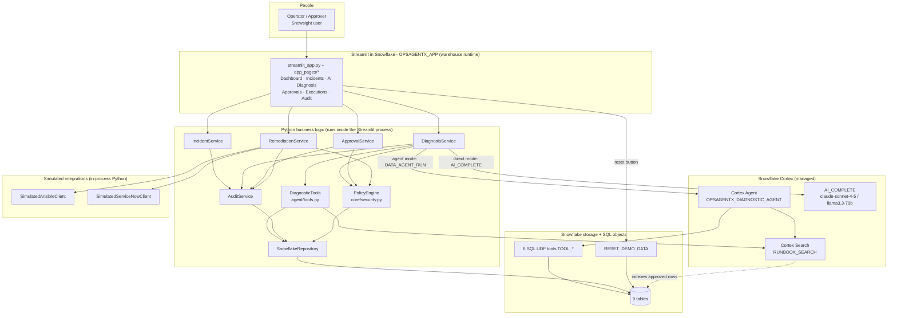
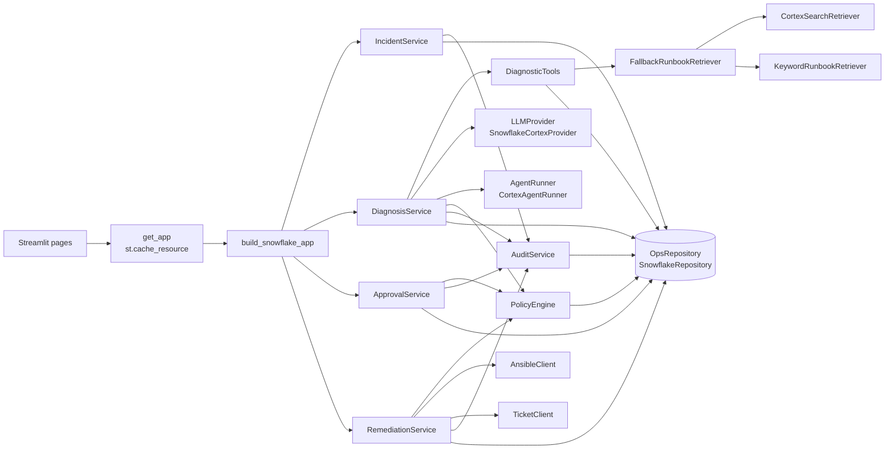
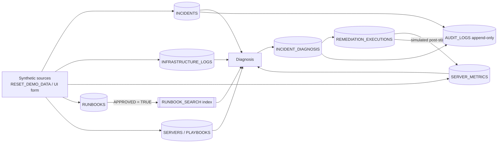
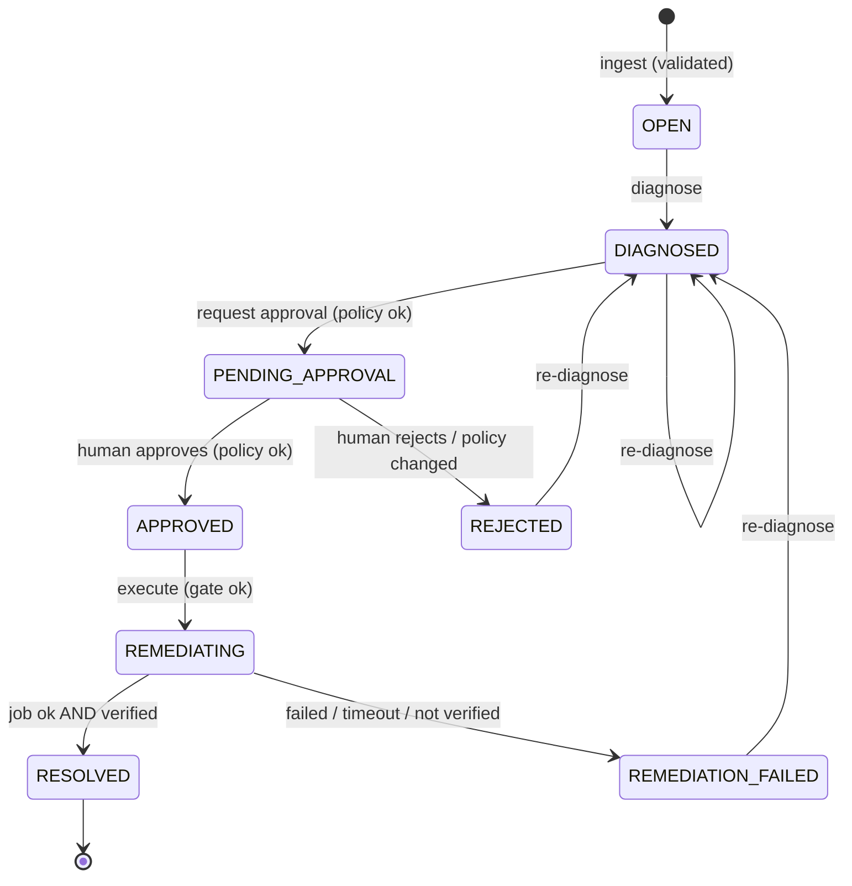
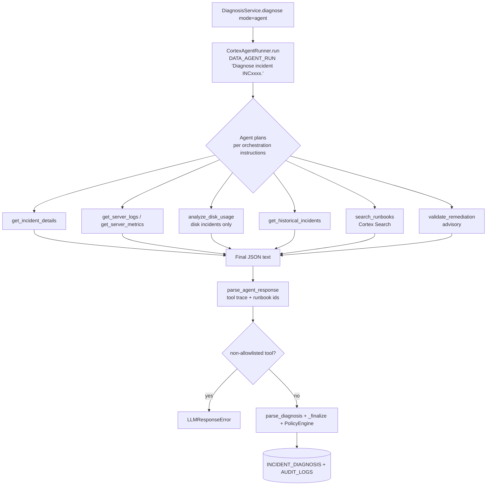

# High-Level Design (HLD)

Scope: the Snowflake Cortex implementation as deployed in `OPSAGENTX_DB.OPSAGENTX_SCHEMA`.
All diagrams reflect the actual call paths in the code.

## 1. Overall system architecture



Key facts:

* There is **no separate backend service**. Business logic is Python imported by the Streamlit
  app and runs in the app's process with the app owner's rights (`OPSAGENTX_ROLE`).
* Every Snowflake call goes through one authenticated Snowpark session
  (`st.connection("snowflake")` inside Snowflake).
* The Cortex Agent is reached with SQL (`SNOWFLAKE.CORTEX.DATA_AGENT_RUN`), **not** the REST API.
* Ansible and ServiceNow are Python simulators; no network call leaves Snowflake.

## 2. Component architecture

| Component | Responsibility | Why it exists | Input | Output | Talks to |
|---|---|---|---|---|---|
| Streamlit UI (`streamlit_app.py`, `app_pages/*`, `ui/common.py`) | Present data, collect human decisions | Operators need one place to drive the lifecycle | Clicks, form input, `st.user.user_name` | Calls to services; rendered pages | All services, repository (reads) |
| `IncidentService` | Ingest, validate, normalize, store incidents; enforce status transitions | Single gate for incoming data and lifecycle rules | Raw dict | `Incident` or `IncidentValidationError` | Repository, AuditService |
| `DiagnosisService` | Gather evidence, call the LLM or agent, validate the answer, apply policy, store | Turn an incident into a trustworthy diagnosis | `incident_id`, mode | `Diagnosis` | DiagnosticTools, LLMProvider, AgentRunner, PolicyEngine, Repository, AuditService, IncidentService |
| `DiagnosticTools` | Seven read-only investigation tools | Give the AI narrow, safe capabilities | Server name, category, incident id, query | Plain dicts | Repository, RunbookRetriever, PolicyEngine |
| `PolicyEngine` | Rules R1-R8 on any proposed remediation | Deterministic security boundary independent of the AI | Playbook, server, environment, category, text | `PolicyDecision` | Inventory repository (SERVERS, PLAYBOOKS) |
| `ApprovalService` | Create approval requests; approve / reject | Human-in-the-loop authorization | `incident_id`; `execution_id` + approver | `RemediationExecution` | PolicyEngine, Repository, IncidentService, AuditService |
| `RemediationService` | Gate, execute, verify, resolve or fail, update ticket | Controlled execution with honest outcomes | `execution_id`, optional Ansible client | `RemediationExecution` | PolicyEngine, AnsibleClient, TicketClient, Repository, IncidentService, AuditService |
| `AuditService` | Write and read audit events | One place that guarantees auditing | Action, actor, details | `AuditEvent` | AuditRepository |
| `SnowflakeRepository` | All SQL against OpsAgentX tables (bind parameters) | Isolate Snowflake-specific storage | Domain models | Domain models | Snowpark session |
| `SnowflakeCortexProvider` | `AI_COMPLETE` with JSON schema | Isolate the LLM vendor | System + user prompt + schema | `LLMResponse` | Snowpark session |
| `CortexAgentRunner` | Run the Cortex Agent; parse tool trace and answer | Isolate agent orchestration | `incident_id` | `AgentRun` | Snowpark session (`DATA_AGENT_RUN`) |
| `CortexSearchRetriever` / `FallbackRunbookRetriever` / `KeywordRunbookRetriever` | Runbook retrieval with fallback | Retrieval-augmented diagnosis | Query, category | `RunbookHit` list | Cortex Search / repository |
| `SimulatedAnsibleClient` | Fake playbook runs with selectable outcome | Demonstrate execution safely | Playbook name, host | `JobResult` or `AnsibleTimeoutError` | none (in-process) |
| `SimulatedServiceNowClient` | Record ticket work notes | Demonstrate ticket update | Incident id, state, note | `TicketUpdate` | none (in-process) |
| `services/factory.py` | Build the object graph | One composition root; swap adapters in one place | Snowpark session | `OpsAgentX` dataclass | everything |

## 3. Component interaction



All arrows into `LLMProvider`, `AgentRunner`, `RunbookRetriever`, `OpsRepository`,
`AnsibleClient` and `TicketClient` cross an **abstract interface** (Python ABC).

## 4. Snowflake architecture

| Layer | Objects (all owned by `OPSAGENTX_ROLE`) |
|---|---|
| Account | Role `OPSAGENTX_ROLE`; warehouse `COMPUTE_WH` (USAGE); compute pool `SYSTEM_COMPUTE_POOL_CPU` (USAGE, currently unused); database role `SNOWFLAKE.CORTEX_USER` |
| Database / schema | `OPSAGENTX_DB.OPSAGENTX_SCHEMA` |
| Tables | `INCIDENTS`, `INCIDENT_DIAGNOSIS`, `INFRASTRUCTURE_LOGS`, `RUNBOOKS`, `REMEDIATION_EXECUTIONS`, `AUDIT_LOGS`, `SERVERS`, `PLAYBOOKS`, `SERVER_METRICS` |
| Code | 6 SQL UDFs `TOOL_*` (return `OBJECT`); SQL procedure `RESET_DEMO_DATA()` (EXECUTE AS OWNER) |
| Cortex | Search service `RUNBOOK_SEARCH`; agent `OPSAGENTX_DIAGNOSTIC_AGENT` |
| App | Stage `APP_STAGE`; Streamlit `OPSAGENTX_APP` (`SYSTEM$WAREHOUSE_RUNTIME`) |
| Views | none (**NOT IMPLEMENTED**) |

## 5. Cortex AI architecture

| Cortex feature | Used for | How it is invoked | Native vs custom |
|---|---|---|---|
| `AI_COMPLETE` (structured output) | Direct-mode diagnosis | `SELECT AI_COMPLETE(model=>?, prompt=>?, model_parameters=>PARSE_JSON(?), response_format=>PARSE_JSON(?), show_details=>TRUE)` | Native function; prompt, schema and validation are custom |
| Cortex Search | Runbook retrieval | `snowflake.core` Python API, fallback `SNOWFLAKE.CORTEX.SEARCH_PREVIEW`; also as an agent tool | Native service; query, filter and score cut-off are custom |
| Cortex Agents | Agent-mode diagnosis (planning + tool use) | `SNOWFLAKE.CORTEX.DATA_AGENT_RUN(agent, body)` | Native orchestration; instructions, tools and post-validation are custom |
| Models | `claude-sonnet-4-5` (primary, agent orchestration), `llama3.3-70b` (AI_COMPLETE fallback) | via the functions above, cross-region inference `ANY_REGION` | Native |

## 6. Data architecture



Details: [DATA_MODEL.md](DATA_MODEL.md).

## 7. Security architecture (summary)

Defense in depth from model output to execution:

```mermaid
flowchart LR
    M[Model answer] --> S1[JSON schema enum<br/>direct mode]
    S1 --> S2[Pydantic validation<br/>+ playbook name shape]
    S2 --> S3[Cross-checks<br/>id, category, approval flag]
    S3 --> S4[PolicyEngine R1-R8<br/>at diagnosis]
    S4 --> S5[PolicyEngine again<br/>at approval request]
    S5 --> S6[Human approval<br/>named user + confirm]
    S6 --> S7[PolicyEngine again<br/>at approval]
    S7 --> S8[Execution gate<br/>approved, not run, policy]
    S8 --> S9[Simulator refuses<br/>unknown playbooks]
```



Details and gaps: [SECURITY_AND_RELIABILITY.md](SECURITY_AND_RELIABILITY.md).

## 8. Integration architecture

| Integration | Interface | Implementation | Status |
|---|---|---|---|
| Ansible Automation Platform | `integrations/ansible.py: AnsibleClient` | `SimulatedAnsibleClient` | Real client **NOT IMPLEMENTED** |
| ServiceNow | `integrations/servicenow.py: TicketClient` | `SimulatedServiceNowClient` | Real client **NOT IMPLEMENTED** |
| GitHub Actions | - | - | **NOT IMPLEMENTED** (no module) |
| Monitoring feed | `IncidentService.ingest(dict)` | UI form, `RESET_DEMO_DATA` | No webhook / API **NOT IMPLEMENTED** |

No external access integration, network rule or secret exists in the account for this project.

## 9. Deployment architecture

```mermaid
flowchart TB
    DEV[Repository files] -->|scripts/run_sql.py| SQL[sql/00-06]
    SQL --> OBJ[(Snowflake objects)]
    DEV -->|scripts/deploy_streamlit.py: PUT 41 files| STG[@APP_STAGE/opsagentx]
    STG -->|CREATE OR REPLACE STREAMLIT ... FROM| APP[OPSAGENTX_APP<br/>warehouse runtime<br/>environment.yml packages]
    APP -->|runs as OPSAGENTX_ROLE on COMPUTE_WH| OBJ
```

## 10. Incident processing workflow



Enforced by `core/models.py: ALLOWED_TRANSITIONS` + `IncidentService.change_status`.

## 11. AI agent workflow



Deep dive: [AI_AGENT_ARCHITECTURE.md](AI_AGENT_ARCHITECTURE.md).

## 12. Human approval and remediation workflow

```mermaid
sequenceDiagram
    actor H as Human (st.user.user_name)
    participant UI as Streamlit
    participant AS as ApprovalService
    participant RS as RemediationService
    participant PE as PolicyEngine
    participant SIM as SimulatedAnsibleClient
    participant DB as Snowflake tables

    H->>UI: Request approval (AI Diagnosis page)
    UI->>AS: request_approval(incident_id)
    AS->>PE: validate (latest diagnosis playbook, incident server)
    AS->>DB: INSERT execution PENDING; incident PENDING_APPROVAL; audit
    H->>UI: tick confirm + Approve
    UI->>AS: approve(execution_id, approver, confirmed=True)
    AS->>AS: reject automated actors
    AS->>PE: validate again
    AS->>DB: APPROVED, approved_by/at; incident APPROVED; audit
    H->>UI: Run simulated playbook (choose outcome)
    UI->>RS: execute(execution_id, ansible=SimulatedAnsibleClient(scenario))
    RS->>RS: gate: APPROVED, NOT_STARTED, incident APPROVED
    RS->>PE: validate a third time
    RS->>DB: RUNNING; incident REMEDIATING; audit EXECUTION_STARTED
    RS->>SIM: run_playbook(name, host)
    SIM-->>RS: JobResult (or AnsibleTimeoutError)
    RS->>DB: write post-state metrics
    RS->>RS: verify() from metrics after job start
    RS->>DB: final status; incident RESOLVED or REMEDIATION_FAILED; audit; ticket note
    RS-->>UI: execution result
```

## 13. Data flow (one request)

```mermaid
sequenceDiagram
    participant UI
    participant DS as DiagnosisService
    participant AG as Cortex Agent
    participant U as TOOL_* UDFs
    participant CS as RUNBOOK_SEARCH
    participant DB as Tables
    UI->>DS: diagnose(INC1001, mode=agent)
    DS->>DB: INSERT AUDIT DIAGNOSIS_REQUESTED
    DS->>AG: DATA_AGENT_RUN
    AG->>U: TOOL_GET_INCIDENT_DETAILS('INC1001')
    U->>DB: SELECT INCIDENTS, SERVERS
    AG->>U: logs, metrics, disk analysis, history
    AG->>CS: query "disk /tmp growth"
    AG->>U: TOOL_VALIDATE_REMEDIATION(...)
    AG-->>DS: content[] (tool_use, tool_result, text)
    DS->>DB: INSERT AUDIT TOOL_CALLED x n, RUNBOOKS_RETRIEVED
    DS->>DB: SELECT SERVERS, PLAYBOOKS (policy)
    DS->>DB: INSERT INCIDENT_DIAGNOSIS; UPDATE INCIDENTS; INSERT AUDIT
```
