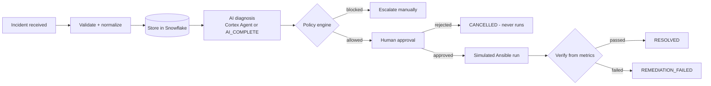

# OpsAgentX - Engineering Documentation (Snowflake Cortex implementation)

This directory is the permanent engineering reference for the Snowflake implementation of
OpsAgentX. A new engineer should be able to understand, reproduce, operate, troubleshoot and
extend the system from these documents alone.

Every statement here was checked against the code in this repository and the live Snowflake
objects in account `XW63202` (region `AWS_AP_NORTHEAST_1`) on 2026-10-31. Anything not proven
is marked **NOT VERIFIED** or **NOT IMPLEMENTED**.

## What OpsAgentX is

OpsAgentX turns an infrastructure incident (disk full, CPU saturated, service stopped, Ansible
job failed) into a diagnosed, policy-checked, human-approved and verified remediation, with a
complete audit trail:



The model proposes; deterministic Python policy decides what is allowed; a named human
approves; verification decides whether the incident is resolved. Ansible and ServiceNow are
**simulated** - nothing touches real infrastructure.

## Quick start (already-deployed account)

1. In Snowsight switch to role `OPSAGENTX_ROLE`.
2. Open **Projects → Streamlit → OPSAGENTX_APP**.
3. Dashboard → *Reset demo data*, then follow `../DEMO.md` (Scenario 1, INC1001).

From scratch: see [DEPLOYMENT_GUIDE.md](DEPLOYMENT_GUIDE.md) (SQL files `00`-`06` + one deploy script).

Run the tests (no Snowflake needed):

```bash
python3 -m venv ~/oax-venv && ~/oax-venv/bin/pip install -r requirements.txt
~/oax-venv/bin/python -m pytest tests -q        # 95 passed (last run 2026-10-31)
```

## Document map

| # | Document | Read it when you want to... |
|---|---|---|
| 1 | **README.md** (this file) | get oriented |
| 2 | [HLD.md](HLD.md) | understand the architecture, components and their interactions |
| 3 | [LLD.md](LLD.md) | understand every module, class, function and SQL object |
| 4 | [SEVEN_STAGE_IMPLEMENTATION.md](SEVEN_STAGE_IMPLEMENTATION.md) | see how the system was built, stage by stage (nine stages) |
| 5 | [AI_AGENT_ARCHITECTURE.md](AI_AGENT_ARCHITECTURE.md) | understand how the AI agent reasons, uses tools and is constrained |
| 6 | [DATA_MODEL.md](DATA_MODEL.md) | understand tables, relationships, states and data flow |
| 7 | [SECURITY_AND_RELIABILITY.md](SECURITY_AND_RELIABILITY.md) | review controls, gaps and production risks |
| 8 | [TESTING_AND_TROUBLESHOOTING.md](TESTING_AND_TROUBLESHOOTING.md) | run tests or fix a problem |
| 9 | [DEPLOYMENT_GUIDE.md](DEPLOYMENT_GUIDE.md) | reproduce the system in an account |
| 10 | [FUTURE_LOCAL_INTEGRATION.md](FUTURE_LOCAL_INTEGRATION.md) | plan integration with the local FastAPI/Ollama/LangGraph OpsAgentX |
| 11 | [LEARNING_GUIDE.md](LEARNING_GUIDE.md) | learn the concepts and prepare for interviews |
| 12 | [ARCHITECTURE_DECISIONS.md](ARCHITECTURE_DECISIONS.md) | see why each choice was made, and the alternatives |
| 13 | [PROJECT_COMPLETION_REPORT.md](PROJECT_COMPLETION_REPORT.md) | see final status, gaps and next steps |

Earlier, shorter documents (still valid, linked from here):
[`../../README.md`](../../README.md) (repository README),
[`../ARCHITECTURE.md`](../ARCHITECTURE.md), [`../DEMO.md`](../DEMO.md) (demo script),
[`../PORTABILITY.md`](../PORTABILITY.md) (local-version porting notes).

## Status at a glance

| Capability | Status |
|---|---|
| Tables, synthetic data, `RESET_DEMO_DATA()` | Implemented, verified |
| Incident validation / normalization | Implemented, verified (unit + live) |
| Direct LLM diagnosis (`AI_COMPLETE` + JSON schema) | Implemented, verified live |
| Cortex Search runbook retrieval (`RUNBOOK_SEARCH`) | Implemented, verified via `SEARCH_PREVIEW`; Python API path **NOT VERIFIED** (fails in sandbox) |
| Cortex Agent with 7 controlled tools | Implemented, verified live via `DATA_AGENT_RUN` |
| Policy engine, approval, simulated Ansible, verification, audit | Implemented, verified (unit + live) |
| Streamlit app (6 pages) | Implemented, verified headless (AppTest); running inside Snowflake **NOT VERIFIED** |
| Cortex Agents REST API | **NOT IMPLEMENTED** (SQL wrapper used instead) |
| Real Ansible AAP, ServiceNow, GitHub integrations | **NOT IMPLEMENTED** (interfaces + simulators only; no GitHub module at all) |
| Dedicated logging module (`core/logging.py`) | **NOT IMPLEMENTED** (audit table is the operational log) |
| Local Ollama/LangGraph version | **NOT IMPLEMENTED** (designed in FUTURE_LOCAL_INTEGRATION.md) |

## Glossary

| Term | Meaning here |
|---|---|
| Incident | A row in `INCIDENTS`; the unit of work |
| Diagnosis | A validated AI answer stored in `INCIDENT_DIAGNOSIS` |
| Playbook | A named, allowlisted Ansible playbook in `PLAYBOOKS` (e.g. `disk_cleanup.yml`) |
| Runbook | A troubleshooting document in `RUNBOOKS`, indexed by Cortex Search |
| Execution | One remediation attempt in `REMEDIATION_EXECUTIONS` (approval + run + verification) |
| Policy engine | `core/security.py: PolicyEngine` - deterministic rules R1-R8 |
| Direct mode | Fixed tool sequence in Python + one `AI_COMPLETE` call |
| Agent mode | Cortex Agent plans and calls tools itself via `DATA_AGENT_RUN` |
